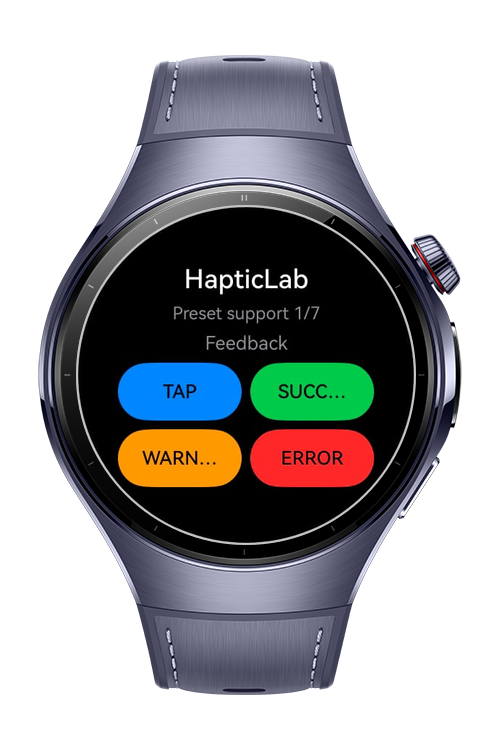
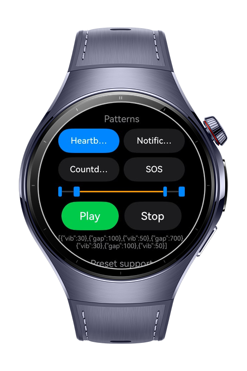
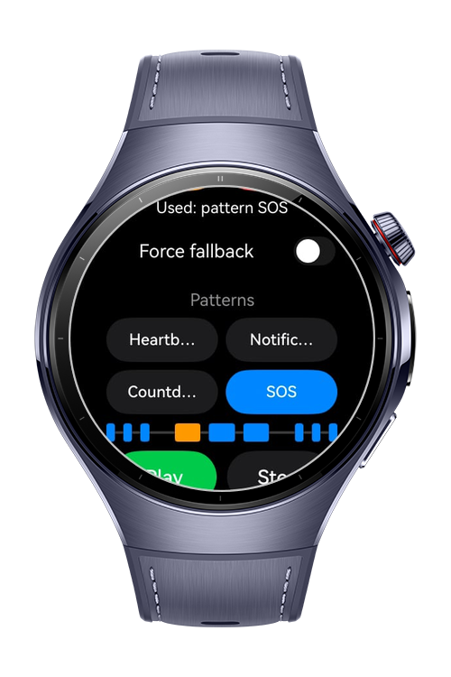

> **Note:** To access all shared projects, get information about environment setup, and view other guides, please visit [Explore-In-HMOS Index](https://github.com/Explore-In-HMOS/hmos-index).

# How to Implement Adaptive Haptics with Fallback on HarmonyOS Wearables

This HarmonyOS wearable sample shows how to give haptic feedback that adapts to the device. The app asks the device which preset vibration effects it supports. For each type of feedback, the app plays a supported preset. If no preset is supported, the app uses a time-based vibration. The app also plays composite patterns, for example a heartbeat or SOS, with a chain of `setTimeout` calls.

# Preview

<div>
  
  
  
</div>

# Use Cases

- Query preset support with `vibrator.isSupportEffect`
- Select the best supported preset for each type of feedback
- Use a time-based vibration when a preset is not supported
- Make composite haptic patterns with chained `setTimeout` calls
- Stop a running pattern at once when a new pattern starts
- Stop all vibration when the page closes or goes to the background

# Technology

## Stack

- **Languages**: ArkTS, ArkUI
- **Frameworks**: HarmonyOS Stage Model
- **Tools**: DevEco Studio, Hvigor, Hypium
- **Libraries**:
	- `@kit.SensorServiceKit` (`vibrator`)
	- `@kit.ArkUI`
	- `@kit.AbilityKit` (`UIAbility`)
	- `@ohos/hypium` (unit tests)

## Required Permissions

- ohos.permission.VIBRATE

## Preset Support

When the app starts, `PresetCatalog` calls `vibrator.isSupportEffect` one time for each of these effects:

```
haptic.clock.timer
haptic.effect.soft
haptic.effect.hard
haptic.effect.sharp
haptic.notice.success
haptic.notice.warning
haptic.notice.fail
```

The app keeps the results. If the call gives an error, the effect counts as not supported. The **Preset support** table shows ✓ or ✗ for each effect.

## Feedback With Fallback

`HapticPlayer` plays four types of feedback. For each type, it tries the presets in order. If no preset is supported, it uses the time-based fallback:

| Feedback | Presets (first supported is used) | Time-based fallback |
|---|---|---|
| TAP | `haptic.effect.soft`, `haptic.clock.timer` | 20 ms |
| SUCCESS | `haptic.notice.success`, `haptic.effect.sharp` | 40 ms |
| WARNING | `haptic.notice.warning`, `haptic.effect.hard` | 120 ms |
| ERROR | `haptic.notice.fail`, `haptic.effect.hard` | 2 × 80 ms, 60 ms gap |

The line under the buttons shows what the app used, for example "Used: preset haptic.effect.soft" or "Used: time 2 × 80 ms". The event log also shows it.

Set **Force fallback** to on to use only time-based vibrations. Use this to test the fallback on a device that supports the presets.

## Composite Patterns

A pattern is a list of steps in a small JSON format:

```json
[{"vib":40},{"gap":80},{"vib":200}]
```

`vib` vibrates for the given time in milliseconds. `gap` waits without vibration.

`PatternSequencer` plays the steps with chained `setTimeout` calls:

1. Each step stops the vibrator.
2. A `vib` step then starts a time-based vibration.
3. A timer starts the next step after the duration of the current step.

| Pattern | Steps |
|---|---|
| Heartbeat | Two double beats: 30 ms, 100 ms gap, 50 ms, 700 ms gap, then again |
| Notification | 40 ms, 80 ms gap, 40 ms |
| Countdown | 3-2-1: 60 ms each second, then a long 300 ms vibration |
| SOS | · · · — — — · · · (80 ms and 240 ms marks) |

The strip under the pattern buttons shows the steps. The width of each step shows its duration. The step that plays now is orange.

## No Overlap

- When a new pattern starts, the sequencer clears the timer of the old pattern and stops the vibrator. The old pattern does not continue.
- A preset feedback also stops a running pattern before it starts.
- **Stop** stops the pattern and the vibrator.
- In `onPageHide` and `aboutToDisappear`, the app cancels all timers and stops the vibrator.

## Errors

If `startVibration` or `stopVibration` gives an error, for example no permission or a device failure, a yellow banner shows. The event log shows the error code.

## Unit Tests

The `entry/src/test` folder has 12 local unit tests. A fake clock runs the timers, so the tests check the order and the time of each vibrator call. For example, `[{"vib":40},{"gap":80},{"vib":200}]` must give:

```
0 ms: stop, vibrate 40 ms   40 ms: stop   120 ms: stop, vibrate 200 ms
```

To run the tests from the command line, use this command in the project folder:

```bash
hvigorw --mode module -p module=entry@default -p product=default -p buildMode=test test
```

# Directory Structure

```
entry/
|   src/
|       main/
│   module.json5
│
├───ets
│   ├───common
│   │       Constants.ets
│   │       Logger.ets
│   │
│   ├───entryability
│   │       EntryAbility.ets
│   │
│   ├───haptics
│   │       HapticPlayer.ets
│   │       PatternSequencer.ets
│   │       PatternStep.ets
│   │       Patterns.ets
│   │       PresetCatalog.ets
│   │       SystemVibrator.ets
│   │
│   └───pages
│           Index.ets
│
|       test/
│           Haptics.test.ets
│           List.test.ets

```

# Constraints and Restrictions

## Supported Device

- Huawei Watch 5

## Notes

- The app requires HarmonyOS 6.0.1 (API 21) or later.
- The supported presets are different on each device. The emulator can show ✗ for all presets.
- `setTimeout` is not exact. A pattern can be some milliseconds late on a busy device. For exact timing, use a custom vibration file (`vibrator.startVibration` with `type: 'file'`) where the device supports it.
- If vibration is off in the watch settings, the watch does not vibrate. The app cannot always detect this.

# License

**How to Implement Adaptive Haptics with Fallback on HarmonyOS Wearables** is distributed under the terms of the MIT License. See the [LICENSE](LICENSE) for more information.
